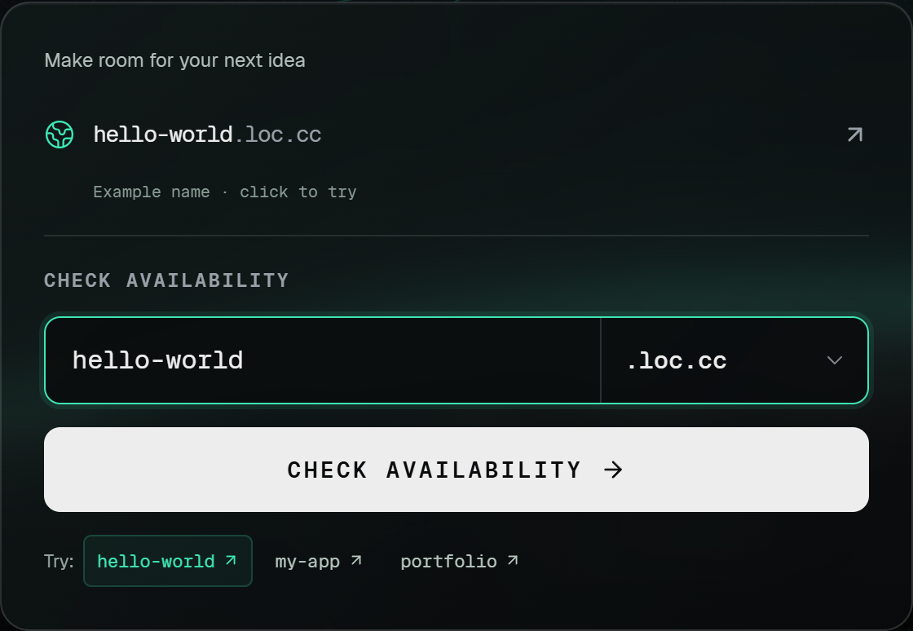

#  Yunamo

**English** · [简体中文](README.zh-CN.md)

Yunamo gives your portfolio, documentation or project demo an address you can keep when you change hosts. Register a subdomain under `loc.cc`, `abc.sd` or `vvpp.cc`, then point it at a static site, a VPS or a server you run yourself.

[Find a name](https://yunamo.com/) · [Create an account](https://yunamo.com/register) · [FAQ](https://yunamo.com/pages/faq)

## Register your first subdomain

1. **Choose a name.** Sign in, enter a project name such as `fieldnotes`, and select a suffix to check availability. The three current suffixes accept names from 3 to 63 characters.
2. **Choose a term.** All three currently cost **100 NL per year**. NL is the unit of your Yunamo balance. Checkout shows the price for your chosen term. If your balance is short, you can top up through NodeLoc and return to the same order.
3. **Connect your host.** Add the full name, such as `fieldnotes.loc.cc`, to your hosting provider’s custom-domain settings. Then open the domain in Yunamo and add the DNS records your provider gives you.

## What goes in the DNS panel?

Suppose you registered `fieldnotes.loc.cc`. In its DNS panel, `@` means that address itself, while `www` means `www.fieldnotes.loc.cc`. These are example records. Use the values supplied by your own host or mail provider.

| What you want to do | Name | Type | Example value |
| --- | --- | --- | --- |
| Point the main address at a VPS | `@` | A | `192.0.2.42` |
| Connect the www address to a hosted site | `www` | CNAME | `project.example.net` |
| Prove control of the domain | `_verify` | TXT | The token issued by the service |
| Receive mail with your mail provider | `@` | MX | `mx.example.net`, priority `10` |

The editor also supports AAAA for IPv6, ALIAS for a hostname at the domain root, SRV for service discovery, CAA for certificate issuance and NS for delegating a name. You can enable DNSSEC with Yunamo’s nameservers. If you already manage DNS elsewhere, switch your subdomain to that provider’s nameservers and publish its DS record in Yunamo if the zone is signed.

## After registration

- **Check a DNS change.** Domain health reports show the latest DNS, HTTP and TLS checks for an individual domain. For a wider outage, check Yunamo’s service status and announcements. [Domain health](https://yunamo.com/domain-health) · [Service status](https://yunamo.com/status) · [Announcements](https://yunamo.com/announcements)
- **Track your NL.** Your balance page lists top-ups, rewards and spending. It also shows which account-linking and invitation rewards you can claim. [Open your balance](https://yunamo.com/wallet)
- **Hand off a project.** When someone else takes over, you can transfer the domain to their Yunamo account. Review the recipient and the fee shown before confirming. [Manage your domains](https://yunamo.com/domains)

## Help and usage rules

Personal sites, project documentation and demos are welcome. Phishing, malware, spam and bulk registration violate the usage rules. For a product question or bug, use GitHub Issues. To report an abusive domain, send its URL and the details through Yunamo’s report form. [Usage rules](RULES.md#english) · [GitHub Issues](https://github.com/nodeloc/yunamo/issues) · [Report abuse](https://yunamo.com/report)

Yunamo also welcomes partners who can contribute servers, bandwidth or domain names. [Sponsorship and partnerships](https://yunamo.com/sponsor)
