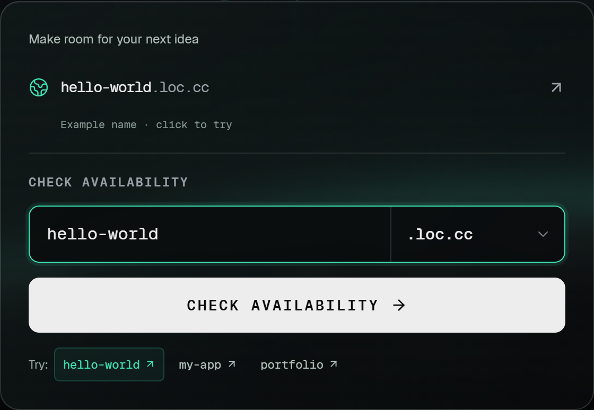

#  Yunamo

[English](README.md) · **简体中文**

Yunamo 为作品集、项目文档和演示站点提供子域名。你可以在 `loc.cc`、`abc.sd` 或 `vvpp.cc` 下选一个名字，把它指向静态网站托管平台、VPS 或自己的服务器。以后搬站，只需更新解析，读者仍然可以用原来的地址访问。

[查询域名](https://yunamo.com/) · [注册账号](https://yunamo.com/register) · [常见问题](https://yunamo.com/pages/faq)

## 注册第一个域名

1. **选名字。** 登录后，在首页输入项目名，例如 `fieldnotes`，再选择后缀查询能否注册。目前三个后缀都接受 3 至 63 个字符的前缀。
2. **选期限。** 三个后缀当前的年费都是 **100 NL**。NL 是 Yunamo 的余额单位，所选期限的实际价格会显示在结算页。余额不足时，可以从 NodeLoc 充值，再返回原订单继续支付。
3. **接入网站。** 在网站托管商的「自定义域名」设置中添加完整域名，例如 `fieldnotes.loc.cc`。然后在 Yunamo 打开这个域名，按托管商给出的值添加 DNS 记录。

## DNS 面板里该填什么？

假设你注册了 `fieldnotes.loc.cc`，面板里的 `@` 就是这个域名本身，`www` 则代表 `www.fieldnotes.loc.cc`。下表展示常见填法，实际配置时请使用托管商或邮件服务商提供的值。

| 你想做什么 | 主机名 | 类型 | 示例记录值 |
| --- | --- | --- | --- |
| 让主域名指向自己的 VPS | `@` | A | `192.0.2.42` |
| 把 www 接到静态网站托管平台 | `www` | CNAME | `project.example.net` |
| 向第三方服务验证域名归属 | `_verify` | TXT | 服务商提供的验证字符串 |
| 使用邮件服务商收信 | `@` | MX | `mx.example.net`，优先级 `10` |

面板还支持用 AAAA 配置 IPv6，用 ALIAS 在域名顶点指向另一主机名，用 SRV 声明服务位置，用 CAA 限制证书签发机构，以及用 NS 委派下级域名。使用 Yunamo 的权威 DNS 时，可以在面板开启 DNSSEC。如果你习惯在其他 DNS 平台管理记录，也可以切换到对方的 NS。若对方已为区域签名，再把它提供的 DS 记录提交到 Yunamo。

## 注册之后

- **排查访问问题。** 在域名健康报告中可以分别查看 DNS 解析、HTTP 访问和 TLS 证书的最近检查结果。若多个站点同时异常，可以查看平台服务状态和维护公告。[域名健康](https://yunamo.com/domain-health) · [服务状态](https://yunamo.com/status) · [公告](https://yunamo.com/announcements)
- **查看余额流水。** 余额页列出充值、奖励和消费记录，也会显示当前可领取的账号关联奖励和邀请奖励。[我的余额](https://yunamo.com/wallet)
- **把项目交给下一位维护者。** 在域名管理中可以把域名转移给另一个 Yunamo 账号，确认前可核对接收方和转移费用。[域名管理](https://yunamo.com/domains)

## 帮助与使用规则

欢迎用子域名搭建个人网站、项目文档和演示站点。钓鱼、传播恶意软件、发送垃圾邮件和批量抢注都违反使用规则。产品问题或功能建议可以提交到 GitHub Issues。举报滥用域名时，请通过官网表单提交相关网址和具体情况。[使用规则](RULES.md) · [GitHub Issues](https://github.com/nodeloc/yunamo/issues) · [举报滥用](https://yunamo.com/report)

如果你愿意提供服务器、带宽或域名，欢迎通过官网联系 Yunamo 商谈合作。[赞助与合作](https://yunamo.com/sponsor)
